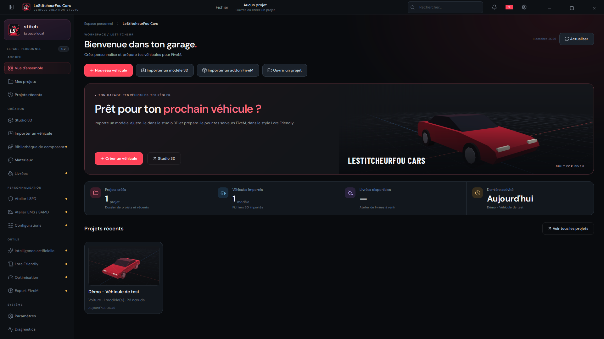
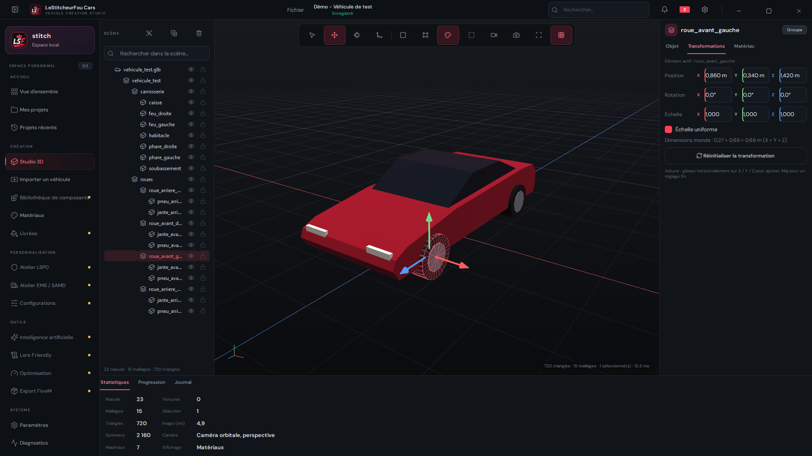

# LeStitcheurFou Cars

[](https://github.com/LeStitcheur/lestitcheurfou-cars/actions/workflows/ci.yml)
[](https://github.com/LeStitcheur/lestitcheurfou-cars/actions/workflows/build-windows.yml)

Atelier Windows de création, d'adaptation et d'export de véhicules **Lore Friendly** pour **GTA V / FiveM**.

> Statut : **v0.2.0 — studio 3D interactif**, identité de la suite LeStitcheur.
> Voir [CHANGELOG.md](CHANGELOG.md) pour ce qui fonctionne réellement aujourd'hui.




## Vision

LeStitcheurFou Cars a pour objectif de permettre de :

- importer un modèle 3D (GLB, OBJ…) ou un véhicule GTA V / FiveM existant ;
- générer une proposition 3D depuis des images de référence (IA locale ou cloud) ;
- adapter les véhicules au style Lore Friendly ;
- les modifier dans un éditeur 3D intégré ;
- créer des configurations LSPD / EMS, ajouter accessoires et équipements d'urgence ;
- créer et personnaliser des livrées ;
- optimiser les modèles et exporter une ressource FiveM compatible.

Tous les types de véhicules sont prévus : voitures, SUV, motos, camions, bateaux, hélicoptères, aéronefs.

## Fonctionnalités de la v0.2.0

| Fonction | État |
|---|---|
| Identité LeStitcheur Control (sidebar noire, accents rouge/rose, fenêtre sans cadre) | ✅ |
| Tableau de bord, projets, projets récents avec miniatures | ✅ |
| Viewport : solide / filaire / matériaux, perspective / ortho, caméra orbitale et libre | ✅ |
| Sélection multiple, gizmos translation / rotation / échelle, annuler / rétablir | ✅ |
| Explorateur hiérarchique (recherche, masquage, verrouillage, regroupement) | ✅ |
| Éditeur de matériaux (couleur, rugosité, métallicité, opacité, texture) | ✅ |
| Import GLB / glTF / OBJ / STL / PLY, FBX via Blender, en arrière-plan | ✅ |
| Projet `.lsfc` v2 : provenance, sauvegarde auto, récupération, enregistrer sous | ✅ |
| Livrées, LSPD, EMS / SAMD, IA, Lore Friendly, Optimisation, Export FiveM | 🕓 « Bientôt », non fonctionnels |

Design system : [docs/DESIGN_SYSTEM.md](docs/DESIGN_SYSTEM.md).

## Installation (utilisateur)

Téléchargez `LeStitcheurFouCars.exe` depuis la page [Releases](https://github.com/LeStitcheur/lestitcheurfou-cars/releases)
ou depuis les artifacts du workflow **Build Windows**. Voir [docs/INSTALLATION.md](docs/INSTALLATION.md).

## Démarrage rapide (développeur)

```powershell
git clone https://github.com/LeStitcheur/lestitcheurfou-cars.git
cd lestitcheurfou-cars
py -3.12 -m venv .venv
.venv\Scripts\activate
pip install -e ".[dev]"
python -m lsfcars
```

Tests : `pytest` — Build Windows : `scripts\build_windows.ps1`.

## Documentation

- [Guide utilisateur](docs/GUIDE_UTILISATEUR.md)
- [Installation](docs/INSTALLATION.md)
- [Architecture](docs/ARCHITECTURE.md)
- [Contribuer](CONTRIBUTING.md)

## Licence

Licence du projet : à définir par le propriétaire du dépôt (aucun fichier `LICENSE` pour l'instant,
ce qui équivaut à « tous droits réservés »).

## Avertissement légal

Ce projet n'est ni affilié ni approuvé par Rockstar Games ou Take-Two Interactive.
Le dépôt ne contient et ne doit contenir **aucun fichier propriétaire GTA V**, aucun secret ni aucun
modèle sous licence restrictive.
