# LeStitcheurFou Cars

[](https://github.com/LeStitcheur/lestitcheurfou-cars/actions/workflows/ci.yml)
[](https://github.com/LeStitcheur/lestitcheurfou-cars/actions/workflows/build-windows.yml)

Atelier Windows de création, d'adaptation et d'export de véhicules **Lore Friendly** pour **GTA V / FiveM**.

> Statut : **v0.8.0 — Lore Friendly Engine : transformation d'un véhicule de référence en création originale (marques fictives, Design DNA, studios de transformation, comparaison, provenance)**.
> Voir [CHANGELOG.md](CHANGELOG.md) pour ce qui fonctionne réellement aujourd'hui.

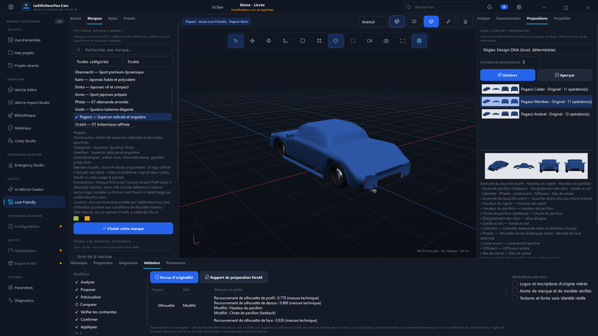
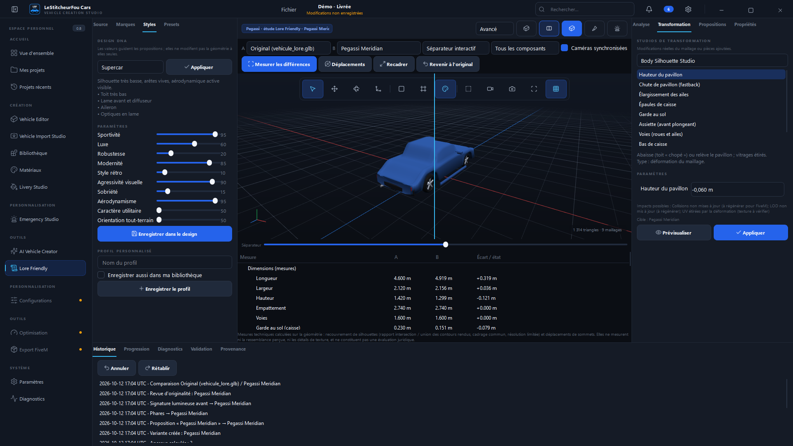
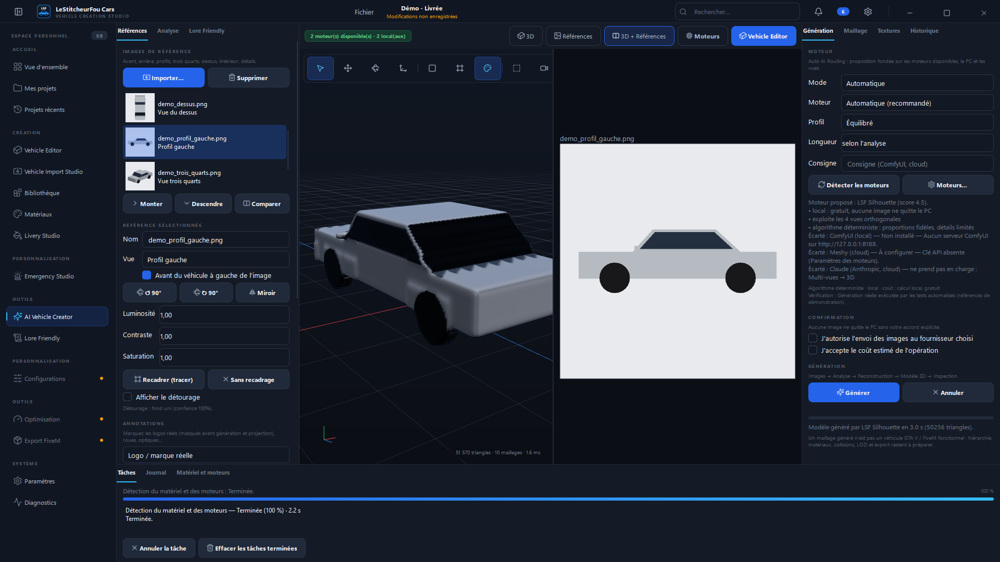
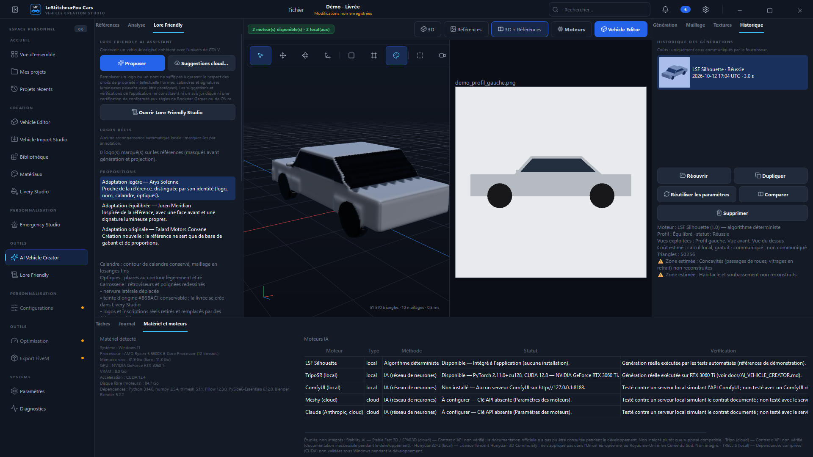
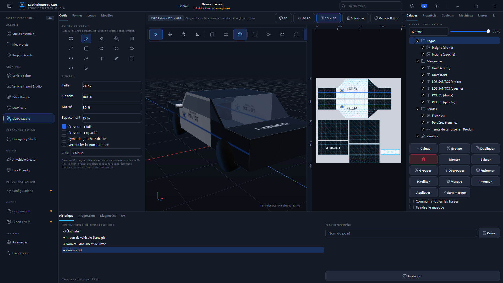
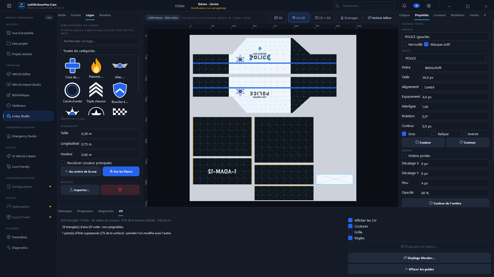
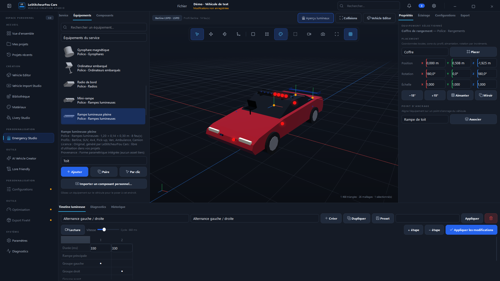
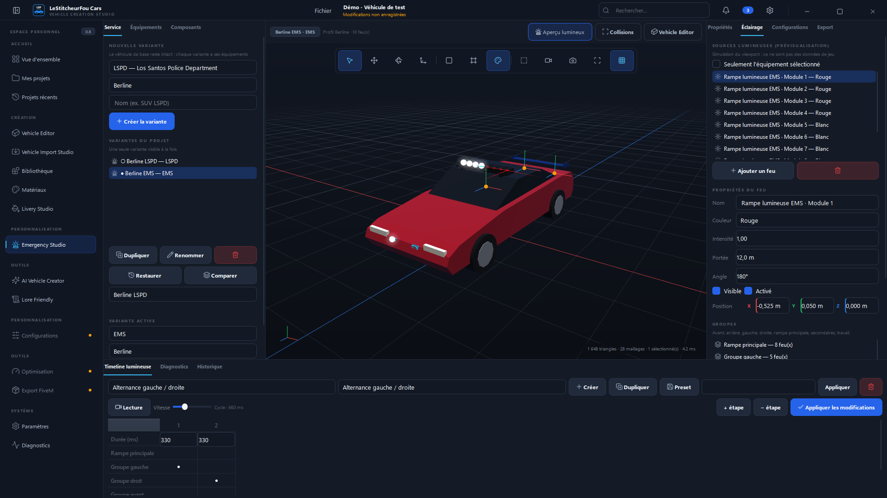
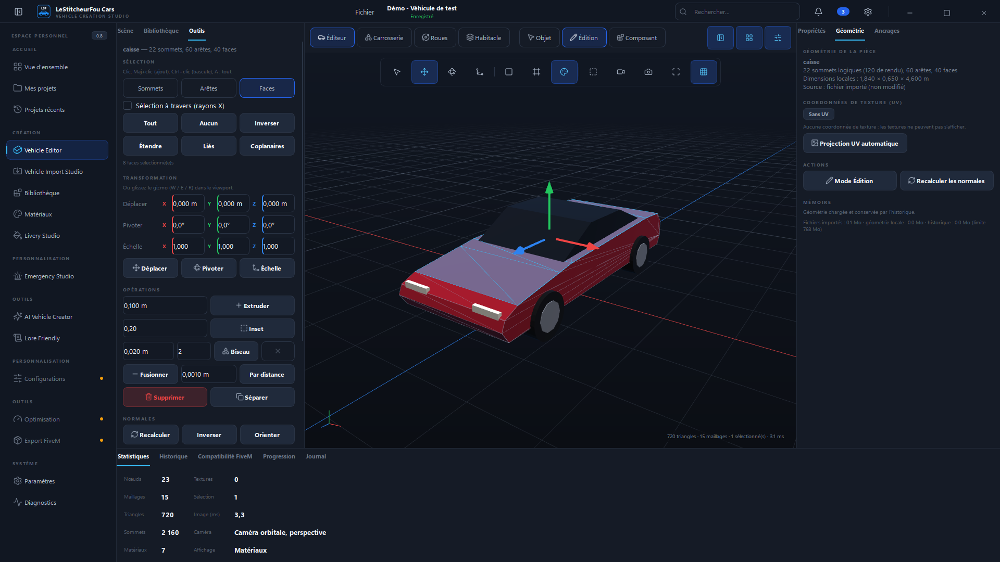
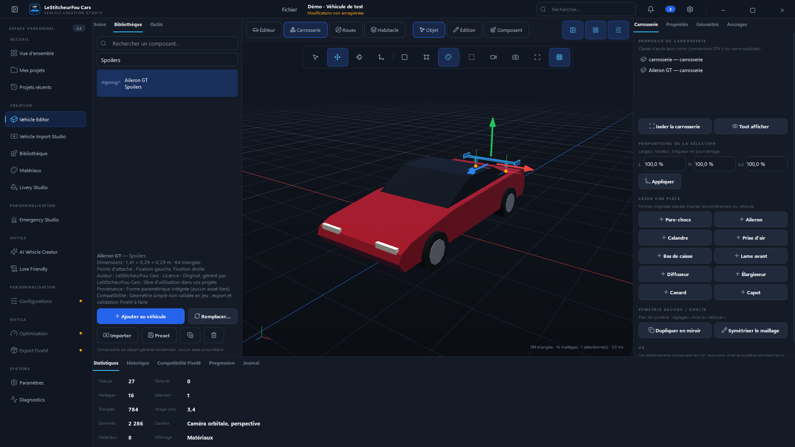
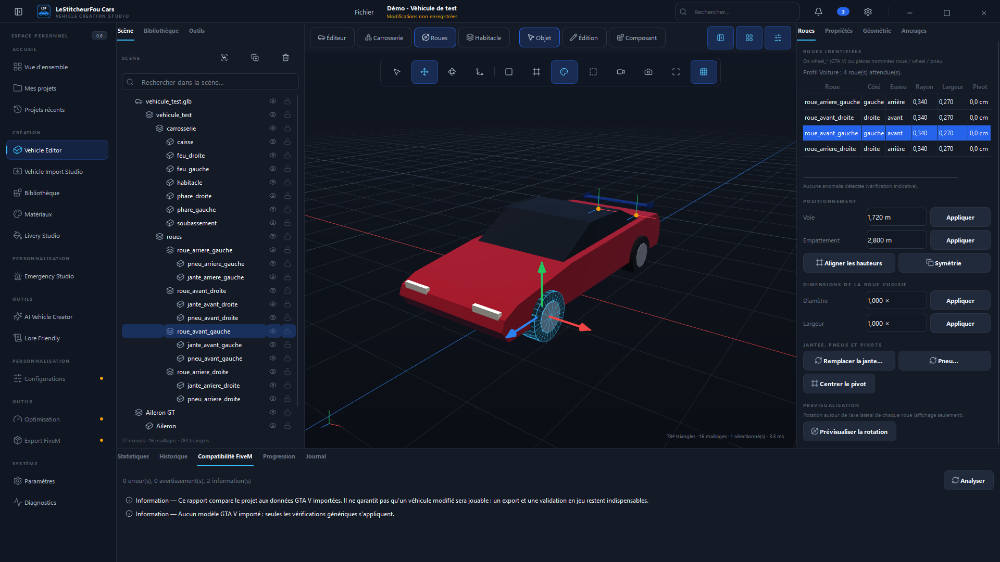
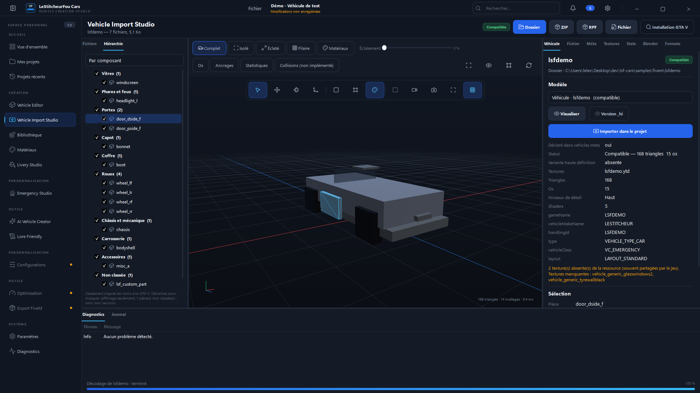

## Vision

LeStitcheurFou Cars a pour objectif de permettre de :

- importer un modèle 3D (GLB, OBJ…) ou un véhicule GTA V / FiveM existant ;
- générer une proposition 3D depuis des images de référence (IA locale ou cloud) ;
- adapter les véhicules au style Lore Friendly ;
- les modifier dans un éditeur 3D intégré ;
- créer des configurations LSPD / EMS, ajouter accessoires et équipements d'urgence ;
- créer et personnaliser des livrées ;
- optimiser les modèles et exporter une ressource FiveM compatible.

Tous les types de véhicules sont prévus : voitures, SUV, motos, camions, bateaux, hélicoptères, aéronefs.

## Fonctionnalités de la v0.8.0

| Fonction | État |
|---|---|
| **Lore Friendly Studio** : source verrouillée, variantes non destructives, points de restauration, modes simplifié / avancé | ✅ |
| Vehicle Design Analyzer : mesures vérifiées, reconnaissances, hypothèses IA et inconnues distinguées ; rapport éditable | ✅ |
| Fictional Brand Library : 20 marques de l'univers GTA V (références créatives, aucun logo) et marques originales | ✅ |
| Design DNA Engine : 10 paramètres, 8 profils intégrés, profils enregistrables | ✅ |
| Lore Concept Generator : plans de transformation, aperçus rendus de la géométrie transformée | ✅ (moteur local) |
| Front / Rear / Body Silhouette Studio, identité lumineuse : 34 opérations réelles (déformations, pièces, matériaux émissifs) | ✅ |
| Design Comparison Studio : côte à côte, séparateur, superposition, filaire, matériaux, mesures | ✅ |
| Design Originality Review : mesures techniques et pistes, aucune certification ni pourcentage de légalité | ✅ |
| Asset Provenance Registry : licences jamais inventées, mentions obligatoires non supprimables | ✅ |
| Plans de transformation par Claude, images conceptuelles 2D par ComfyUI | ⚠️ testés contre serveurs simulés seulement |
| **AI Vehicle Creator** : Reference Studio, analyse, génération, assistant maillage, textures, Lore Friendly, historique | ✅ |
| AI Engine Manager : interface commune des moteurs, détection matérielle, profils, Auto AI Routing, file de tâches, cache | ✅ |
| Génération locale **LSF Silhouette** (multi-vues, algorithme déterministe, intégré) | ✅ génération réelle |
| Génération locale **TripoSR** (réseau de neurones, une image, installation séparée) | ✅ génération réelle (GPU testé : RTX 3060 Ti) |
| Adaptateurs **Meshy** (cloud 3D), **Claude** (analyse, Lore), **ComfyUI** (workflow utilisateur) | ⚠️ testés contre serveurs simulés seulement |
| Clés API chiffrées (DPAPI), confirmation avant transfert cloud et opération payante | ✅ |
| Vehicle Vision Analyzer (proportions, roues, couleurs, incohérences ; mesures approximatives) | ✅ (règles locales) |
| AI Mesh Assistant (diagnostics exacts, corrections déterministes annulables, suggestions, validation humaine) | ✅ |
| AI Texture Creator (projection des références, normal map dérivée, cartes par règles, variantes) | ✅ (pas d'AO locale) |
| Lore Friendly : marques et noms fictifs filtrés, 3 propositions, ajustements géométriques, provenance | ✅ (aucune certification) |
| **Livery Studio** : vue 3D, vue UV 2D, vue partagée ; calques raster / vecteur / texte / image / bandes 3D / groupes / masques | ✅ |
| Peinture 3D réelle sur la carrosserie (texels modifiés, coutures UV, symétrie 3D, pression tablette) | ✅ |
| Canvas 2D : zoom, règles, guides, UV, sélection, lasso, transformation, copier / coller | ✅ |
| Texte éditable, logos (10 emblèmes originaux, import PNG / SVG / JPG / WEBP avec licence) | ✅ |
| Bandes et marquages orientés d'après le dépliage réel ; 11 modèles de livrées | ✅ |
| Inspecteur UV, projection boîte, dépliage Blender (sur confirmation) | ✅ (dépliage : Blender requis) |
| Variantes de livrées, association Emergency Studio | ✅ |
| Export PNG / TIFF / WEBP / DDS + mipmaps, vérification ; préparation YTD | ✅ (aucun .ytd écrit) |
| `.lsfc` v6 (calques, masques, logos, polices ; migration v1 → v6) | ✅ |
| **Emergency Studio** : variantes non destructives (LSPD, BCSO, SAHP, EMS, SAMD, LSFD, Rescue, personnalisé) | ✅ |
| Bibliothèque de 33 équipements originaux (Police, EMS, Fire) et import d'équipements personnels | ✅ |
| Placement interactif : zones par profil, clic / glisser-déposer sur la carrosserie, magnétisme, symétrie, miroir, collisions approximatives | ✅ |
| 12 profils de véhicules (berline → aéronef) et profils personnalisés | ✅ |
| Lighting Studio : sources, groupes, timeline des motifs, presets, prévisualisation déterministe | ✅ (simulation viewport) |
| Export `carcols.meta` (non-ELS), MISS-ELS et JSON intermédiaire ; ELS classique expliqué comme indisponible | ✅ (non garanti en jeu) |
| Sirènes : modes liés aux motifs, tonalités synthétisées originales, aperçu | ✅ (aperçu Windows) |
| Intérieurs Police / EMS / Fire, données de livrée, contrôle Lore Friendly | ✅ (livrée : données seules) |
| Documents de studio Emergency (`.lsfc` depuis v5) | ✅ |
| **Vehicle Editor** : modes Objet, Édition (sommets / arêtes / faces), Composant | ✅ |
| Édition réelle du maillage : déplacer, pivoter, échelle, extrusion, inset, fusion, suppression, normales, symétrie, séparation, projection UV | ✅ |
| Biseau d'arêtes (Blender en processus auxiliaire) | ✅ si Blender est installé |
| **Bodywork Studio** : panneaux, proportions, création de pièces originales, symétrie gauche / droite | ✅ |
| **Component Library** locale (25 composants originaux, import, presets, recherche, filtres) | ✅ |
| **Replace Component** avec prévisualisation, options et historique réversible | ✅ |
| **Wheel Editor** : identification, voie, empattement, alignement, échelle, pivots, profils, aperçu de rotation | ✅ |
| **Interior Studio** : isolation, carrosserie masquée, caméra intérieure, configurations civil / police / EMS / commandement | ✅ |
| **Attachment Points** : création, axes, contraintes, métadonnées, association | ✅ |
| Matériaux étendus : carte de normales, UV, 9 presets automobiles, shader GTA V indicatif | ✅ |
| Historique : transactions, budget mémoire, points de restauration ; rapport de compatibilité FiveM | ✅ |
| Géométrie locale, ancrages, variantes de composants (`.lsfc` depuis v4) | ✅ |
| Design **Dark Premium** (palette bleue officielle, design system centralisé) | ✅ |
| **Vehicle Import Studio** : dossier FiveM, ZIP, RPF non chiffré, fichiers isolés, installation GTA V | ✅ |
| Analyse automatique : fichiers, modèles, variantes `_hi`, textures, métadonnées, dépendances, diagnostics | ✅ |
| Décodage natif `.yft` (squelette, géométrie, roues, shaders) et `.ytd` (DXT, BC, non compressés) | ✅ |
| Lecteur de métadonnées (vehicles, handling, carvariations, carcols…) avec vérifications croisées | ✅ |
| Inspection : composants classés, isolement, vue éclatée non destructive, filaire, os, ancrages, stats | ✅ |
| Inspecteur de textures : aperçu, format, transparence, mémoire, export PNG / DDS | ✅ |
| Import dans le projet avec manifeste versionné, métadonnées d'os conservées | ✅ |
| Blender / Sollumz : détection et sondage réels, tâches annulables | ✅ (Sollumz non testé : non installé) |
| Collisions `.ybn` (géométrie), export FiveM, écriture des formats GTA V | 🕓 non implémentés |
| Matériaux, projets, sauvegarde auto (v0.2) | ✅ |
| Optimisation, Export FiveM complet (YFT, YTD) | 🕓 « Bientôt », non fonctionnels |

Lore Friendly Engine, studios, comparaison et limites : [docs/LORE_FRIENDLY_ENGINE.md](docs/LORE_FRIENDLY_ENGINE.md).
AI Vehicle Creator, moteurs, cloud et limites : [docs/AI_VEHICLE_CREATOR.md](docs/AI_VEHICLE_CREATOR.md).
Livery Studio, peinture 3D et export : [docs/LIVERY_STUDIO.md](docs/LIVERY_STUDIO.md).
Emergency Studio, adaptateurs et limites : [docs/EMERGENCY_STUDIO.md](docs/EMERGENCY_STUDIO.md).
Vehicle Editor, outils et limites : [docs/VEHICLE_EDITOR.md](docs/VEHICLE_EDITOR.md).
Compatibilité détaillée des formats et limites : [docs/FIVEM_IMPORT.md](docs/FIVEM_IMPORT.md).
Design system : [docs/DESIGN_SYSTEM.md](docs/DESIGN_SYSTEM.md).

## Installation (utilisateur)

Téléchargez `LeStitcheurFouCars.exe` depuis la page [Releases](https://github.com/LeStitcheur/lestitcheurfou-cars/releases)
ou depuis les artifacts du workflow **Build Windows**. Voir [docs/INSTALLATION.md](docs/INSTALLATION.md).

## Démarrage rapide (développeur)

```powershell
git clone https://github.com/LeStitcheur/lestitcheurfou-cars.git
cd lestitcheurfou-cars
py -3.12 -m venv .venv
.venv\Scripts\activate
pip install -e ".[dev]"
python -m lsfcars
```

Tests : `pytest` — Build Windows : `scripts\build_windows.ps1` —
addon de démonstration (synthétique) : `python scripts\generate_demo_addon.py`.

## Documentation

- [Guide utilisateur](docs/GUIDE_UTILISATEUR.md)
- [Lore Friendly Engine](docs/LORE_FRIENDLY_ENGINE.md)
- [AI Vehicle Creator](docs/AI_VEHICLE_CREATOR.md)
- [Livery Studio](docs/LIVERY_STUDIO.md)
- [Emergency Studio](docs/EMERGENCY_STUDIO.md)
- [Vehicle Editor](docs/VEHICLE_EDITOR.md)
- [Vehicle Import Studio et formats GTA V / FiveM](docs/FIVEM_IMPORT.md)
- [Design system Dark Premium](docs/DESIGN_SYSTEM.md)
- [Installation](docs/INSTALLATION.md)
- [Architecture](docs/ARCHITECTURE.md)
- [Contribuer](CONTRIBUTING.md)

## Licence

Licence du projet : à définir par le propriétaire du dépôt (aucun fichier `LICENSE` pour l'instant,
ce qui équivaut à « tous droits réservés »).

## Avertissement légal

Ce projet n'est ni affilié ni approuvé par Rockstar Games ou Take-Two Interactive.
Le dépôt ne contient et ne doit contenir **aucun fichier propriétaire GTA V**, aucun secret ni aucun
modèle sous licence restrictive. LeStitcheurFou Cars ne contourne aucun chiffrement, DRM ou
protection de ressource (archives officielles chiffrées, FiveM Asset Escrow) : ces contenus sont
détectés et refusés avec une explication.
